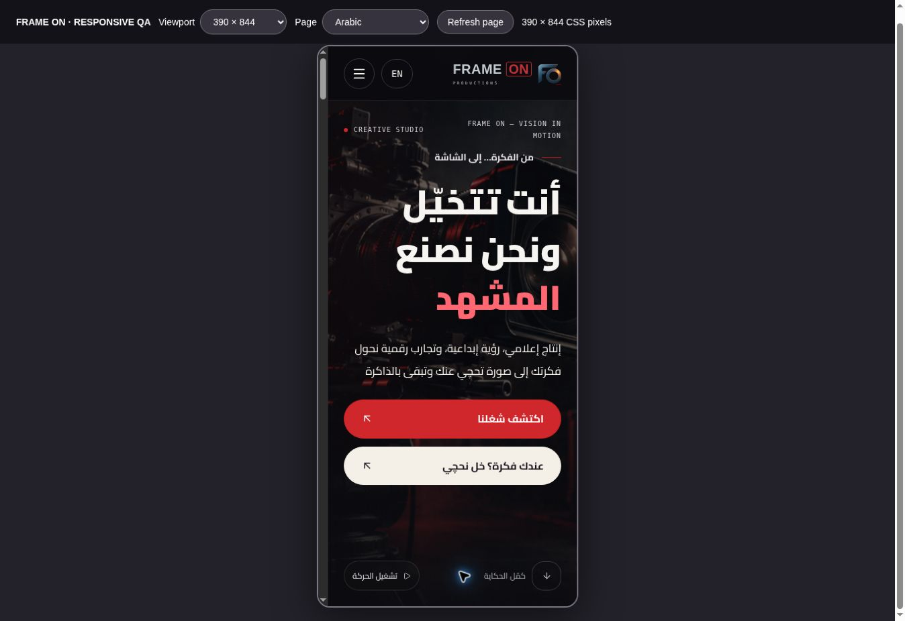
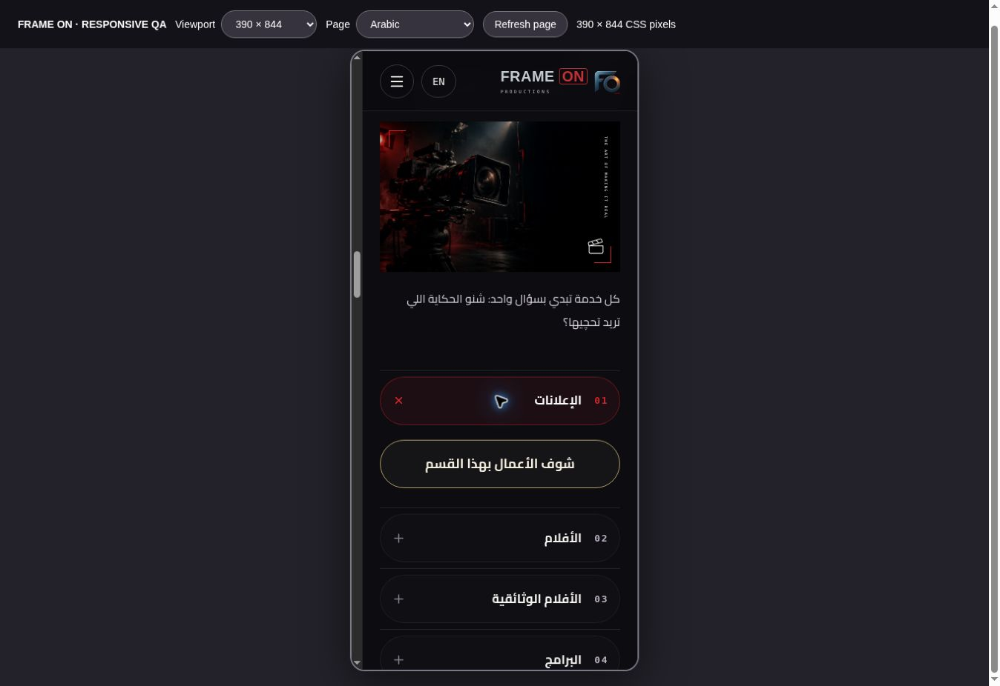
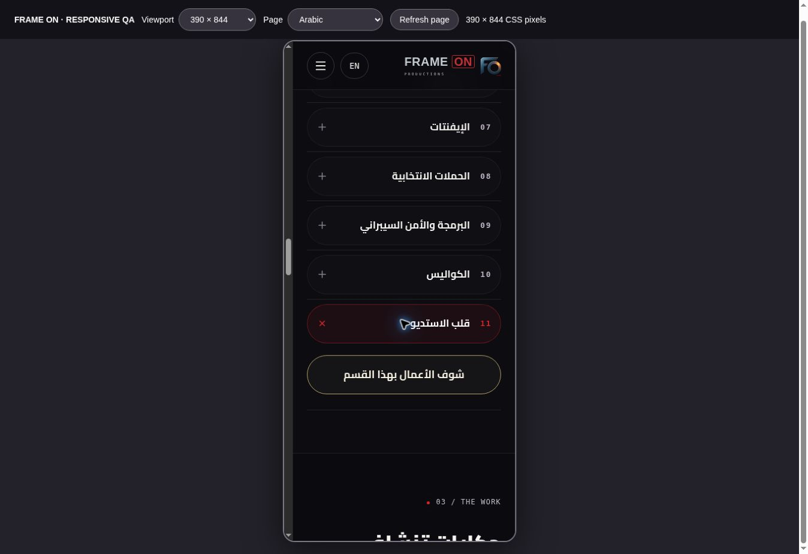

# Mobile interface revision — 21 October 2026

The public Arabic/English experience now uses a larger reading scale, high-contrast copy and oval action controls. The hero headline fills the mobile content width, its secondary CTA uses ivory against the dark scene, and the production strip repeats FO marks. About/service paragraphs are larger, their links/tags are rounded, and the team headline is followed by the Frame On lockup regardless of whether team members have been added.

The studio-journal heading is a direct `#studio-heart` link that selects the independent **قلب الاستديو** work category. The previous explanatory/empty journal paragraphs have been removed. Existing published journal posts still work. The contact brief has exactly four fields: name, phone, email and idea. It validates the phone and browser email field, normalizes Arabic/Persian digits, and prepares/copies the brief locally. It does not send an email or submit a lead automatically. Standalone Telegram CTAs have been removed; contact/footer navigation uses branded social marks.

Facebook, Snapchat, Telegram and TikTok use the owner's supplied account URLs. Instagram has no URL in the source settings or the connected database settings. Its mark is present with an unavailable label and no fabricated destination. Saving the official Instagram URL in **النصوص والتواصل** enables its link automatically.

## Browser evidence

The actual React components and final CSS were exercised in Chrome through the supported Sites preview supervisor. An iframe harness set the document's CSS viewport size; it is not an iOS/Safari or Android hardware test. A direct Next.js development preview rendered server HTML but did not hydrate through that preview setup, so it was replaced for UI QA with a static bundle of the same source components. The production Next.js build was checked separately. QA harness files are not part of the application or this repository.

Arabic and English were measured at **320, 360, 375, 390, 430 and 768 CSS pixels**:

- No page-width overflow or clipped hero, contact or team headings was observed
- Main action links, service buttons, social links and contact inputs met the 44-pixel minimum height check
- Hero body copy was 17 px at phone widths; About copy was 18 px
- Contact inputs/textareas were 16 px, with the single-line inputs approximately 59 px high
- Rendered paragraphs/headings had no terminal full stops

The 1440-pixel desktop header also fit without overflow. The language screen was checked at 320/390/430 pixels, and its English choice opened the English interface. The staff login screen was checked at the same widths; the final 320-pixel check measured the return link at 45 px, password visibility at 48 px, inputs at 56 px and submit at approximately 57 px.

Actual interactions verified:

1. Mobile menu opens; service selection closes it and opens the chosen service
2. The studio link selects the behind-the-scenes category and updates the fragment
3. An invalid phone prevents brief generation
4. Arabic-digit phone entry is normalized in the generated brief, which includes name, phone, email and idea
5. Copying shows the success message
6. The motion control pauses the FO marquee, and the footer return link reaches the hero
7. Footer links retain the configured URLs and open a separate tab with `noopener noreferrer`

## Build and regression checks

- Production `npm run build`, including TypeScript, passed
- `npm run test:copy` passed punctuation, paragraph, ellipsis, decimal, email and URL cases
- The 21 isolated media/backend checks and 18 authentication/backend checks passed
- The existing 24 React/JSDOM interaction checks passed

## Production follow-up

The existing GitHub integration automatically deployed `e25fac95eae239a0668e7bd692e7dbcd77efab5b` successfully to the canonical Vercel project. A direct browser check at `https://frame-on-productions.vercel.app/ar` confirmed the new hero, FO strip, oval CTAs and four contact fields. The hero CTAs measured 57 px high with a 999 px radius; contact inputs used 16 px text. The studio link selected the behind-the-scenes category, and the contact form prepared its local brief. The existing administrator session loaded the dashboard successfully.

A synthetic production upload then exercised real browser image encoding: the 7.2 MiB PNG became a 1.9 MiB WebP, saving 74%. Storage rejected the initial TUS creation request with HTTP 400 / `AccessDenied` / `Invalid Compact JWS`. Storage logs and the upstream signed-upload example identified the route mismatch: scoped `x-signature` tokens require `/storage/v1/upload/resumable/sign`; the unsigned route expects JWT authentication. The runtime endpoint and regression assertion were corrected, and the 21 media/backend checks plus the production build passed again. See the upstream [signed example](https://github.com/supabase/supabase/blob/master/examples/storage/resumable-upload-signed-uppy/index.html) and [maintainer clarification](https://github.com/supabase/storage/issues/1268).

After Vercel successfully deployed `ebdf38eb51cf79e30285de4699d31b9788110ed4`, both synthetic files completed the real browser upload and server confirmation flow. The saved **فحص الرفع والتجاوب — مسودة تجريبية خاصة** draft contains two private objects: a 1,969,834-byte WebP and a 37,828,039-byte MP4 (36.1 MiB, above the former 30 MiB limit). A database read confirmed `published = false` and two linked media records. Reopening the saved editor loaded the 2200 × 1400 image and the 1280 × 720, nine-second video; the video started playing without a media error. The synthetic draft is retained as private verification evidence and is not published. No owner file or account was removed or replaced.

An HTTP request without an administrator session to the draft video's application media URL returned 404, confirming that the saved test file is not publicly readable through that route.

## Service category actions — 21 October 2026

Each expanded service category contains only its work-preview button. The category-specific heading, paragraph, tags and extra inline arrow were removed from these panels. The shared action is centered, uses an ivory 18 px label, a muted gold border and a 999 px radius, and selects the matching work category when pressed. On phones it uses the available row width; on desktop its width is capped at 380 px.

The actual component and stylesheet preview passed all ten category-opening and work-selection interactions in both Arabic and English. Every panel contained exactly one button and no heading, paragraph, tag group or icon. Final 320 px checks in both languages measured the button at 265 × approximately 66.6 px with no text overflow. At 390 px the Arabic button measured 327 × approximately 66.6 px and was centered with zero offset. Tablet/desktop checks at 768 and 1440 px also showed centered buttons and no page-width overflow. This is Chrome CSS viewport QA rather than physical iOS or Android hardware testing. The production Next.js build, including TypeScript, passed with the final source.

## Independent Studio heart category — 21 October 2026

**قلب الاستديو / Studio heart** is now the eleventh service category, with its own `studio-heart` identifier. The shared category list supplies the navigation menu, service accordion, work filter, administrator project selector and server validation. The studio-journal heading targets `#studio-heart` and explicitly selects this category, including when the fragment already has that value. Direct entry with that fragment also opens the category. The separate `behind-scenes` category and fragment still select **الكواليس**.

Read-only inspection of the connected database confirmed that `entries.category` is text and has no category check constraint; adding this category needs no schema migration or existing-content rewrite. The 22 isolated media/backend checks passed, including saving and publicly listing a Studio heart entry without changing its category. All 26 React/JSDOM interaction checks passed, including the eleven-item menu, keyboard End navigation, the new journal target and separate CMS options for Studio heart and Behind the scenes. The production Next.js build and TypeScript passed.

Browser QA confirmed the new heading destination, independent filters, repeated same-fragment navigation and initial English deep-link selection. At a 320 px CSS viewport the mobile menu exposed eleven choices, selected the new category and closed normally; the new panel's button measured 265 × approximately 66.6 px with no text or page-width overflow. The old Arabic behind-the-scenes deep link still selected its original category. The screenshot below uses a 390 × 844 CSS viewport and shows the separate tenth and eleventh categories.

